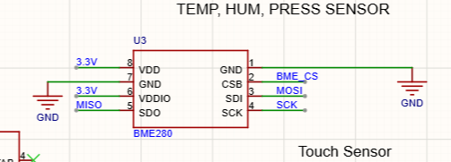
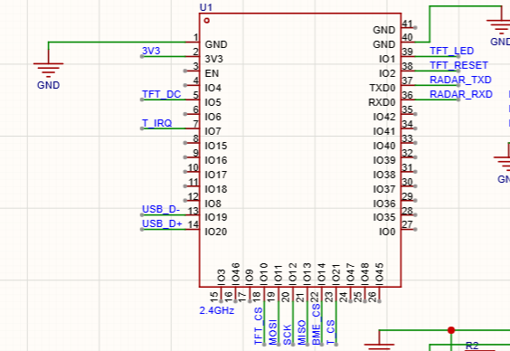
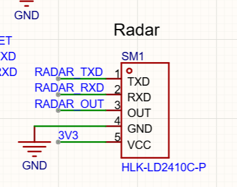
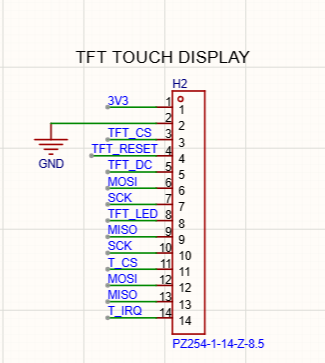
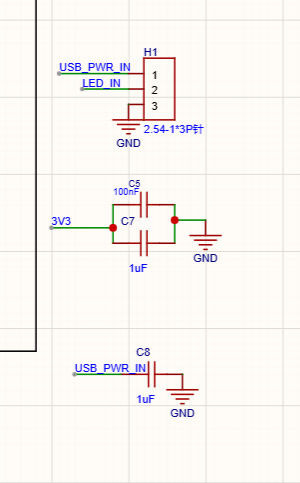
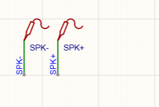
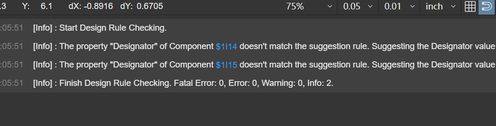
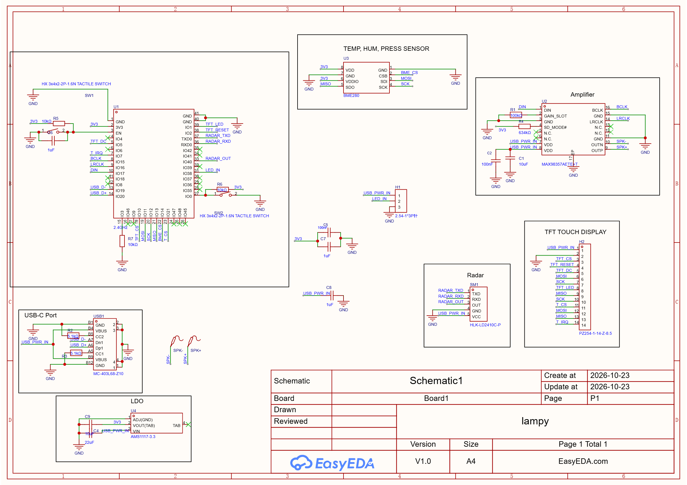
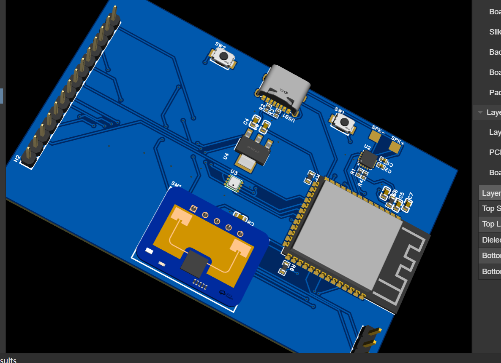
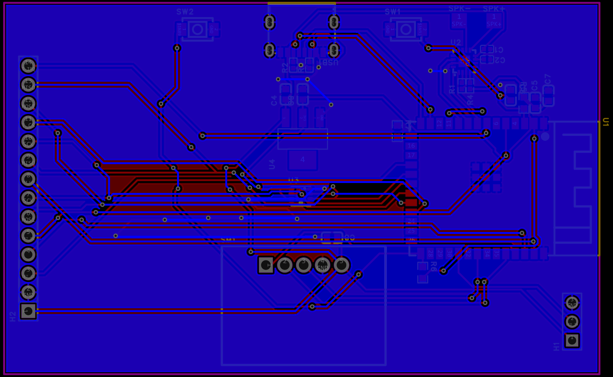

### 10/19/2026 Started project!! (Arya: 45 mins)

Arya: Today, we started working on this project! We decided to make a smart WS2812B lamp with Google Home integration! We started off with placing things on the schematic, and I went and searched for a decent ESP32-S3 module! We did place some simple things on the schematic like a radar, LDO, etc. We decided to do a radar so that the lamp would smartly turn on when someone approaches it. We might be adding some more to the schematic, but I feel like we have the core components in.

Lapse: https://lapse.hackclub.com/timelapse/cUiMAB_ottTp

Funmi: Day 1 of starting a new project. this might be our last thirdpspace proj so i wanted it to be ai-b2b-saas lol! but we're making a (sophisticated) Aura lamp. (teeammate said it doesn't have to be sophisticated cuz it's just a lamp, this is why you shouldn't listen to boys when they speak!

Anyways, we sourced and added components based on what we were planning out! We added an esp32 s3 (ESP32-S3-WROOM-1-N16R2), and then added the same bme280 temp humidity and pressure sensor we used in AtmosCore, a USB-C port, a good LDO, a radar presence sensor, and a capacitative touch sensor (the sliding one) - this one had 8 touch poitns! As we were still plannign  out and discussing, we decided to add a touch tft display! and so we removed the sliding sesnor!

Lapse: https://lapse.hackclub.com/timelapse/J1cavKiu7AhE

### 10/20/2026 Finished component placement + wired MAX98357A!! (Arya: 1hr)

Arya: Today, we managed to finish the placement for the components on the PCB and we currently to not have too much. I also started and finished the wiring of the MAX98357A on the schematic! I did do a lot of reading of the datasheet for this since I am used to the modules, not the bare chips. I feel like there is some more things that need to be added to the schematic for the speaker amplifier so I will take a deeper look on the wiring when I work on this again. I will try to get this amplifier to the loudest setting so that the smart lamp would fill a lot of the area around it with loud sound. 

Lapse: https://lapse.hackclub.com/timelapse/H03_j8s2ZEAL

### 10/21/2026 Datasheet Reading + Fixing Pins!! (Arya: 30 mins)

Arya: Today, I did not have too much time to work, but I managed to get some fixes in for some pins and also get some datasheet reading in! I started off with the pins for the TFT touch display because I noticed that they were wrong so I fixed the wiring and renamed the symbols so that the pinout would match the pinout of a TFT touch display! I then moved on to the amplifier from yesterday, but I did not have enough time to find what I was looking for and give it the correct values. I did manage to get some reading of the datasheet in, though. I initially thought that the preset channel would be mono audio but that turned out to be false, so I saw an example schematic and was going to copy that, before I realized that the values shown were for 1.8V, which was very different than the 5V or 3.3V that will be available. I would have never noticed this if I had not read the smaller text on the datasheet. I also had some trouble finding the resistor values needed to set the amplifier to mono mode since that will need to be the default as we only have one speaker. I will try to get this done next time, so hopefully I have enough time then!

Lapse: https://lapse.hackclub.com/timelapse/ADDqVgfokMFf

Funmi: I wiredd up the usb-c port after searching it to confirm the right connections from our last wiring! I then began wiring the tft touch display! i had to research this one to get the pinout right cuz i couldn't find legible 14 pinout lcd anywhere! I also understood that both the tft and it's touch used the same spi bus! (in short more of how spi works)

Lapse: https://lapse.hackclub.com/timelapse/GiAZ7oVy02oq

### 10/22/2026 Finished wiring MAX98357A + wired LDO!! (Arya: 30 mins)

Arya: Today, I read through the datasheet some more and completed the wiring for the amplifier! I did use some AI to help me and I went back and confirmed it with the datasheet! I found a proper table that gave example values for pullups for the voltages listed, and I put the proper resistor needed in! I conformed all of the other wiring and it was correct! I also started and finished the wiring for the LDO. The LDO was not hard to wire, but I did get a little stuck on the tab pin on the footprint, which the datasheet did not mention at all for wiring.

Lapse: https://lapse.hackclub.com/timelapse/M89l0f_t1XQr

Funmi: getting to the point where i'm able to read a micro's pinout and know what pins to use for what primarily w/o needing Google searches and AI. Today, I finsihed up the wiring of the tft display and touch to the esp32! (each of the both w different CS pins and sharing the same SPI buses), same for the bme280 which I started next and finished wiring to the esp32. and then I wired up the radar asw! I searched up connections to make sure everythign was right.. still used some Google and AI, but I got a bettter understanding of SPI and UART comm protocols and other stuff!

Lapse: https://lapse.hackclub.com/timelapse/WWVpwd83nshN

# 10/23/2026 Started and Finished the PCB!! (Arya: 1hr 30mins)

Arya: Today, we finished up with the schematic and started and finished the PCB! I started off with placing the major parts on the PCB to the intended layout, and we then placed the minor things like the resistors and the capacitors. We then started wiring! I did notice some problems from the schematic while I was wiring so I fixed them! Wiring did not take that long, and we did wire everything other than the GND first because we were going to do a ground fill. After we finished the wiring and did the ground fill, there were some areas left that were not connected to ground, so we connected them to each other! And now, we are officially done with the PCB for this project! We plan on starting the CAD and the code for the project next time we work on this!

Lapse: https://lapse.hackclub.com/timelapse/VUYm8VxBadQN

Funmi: I wired the enable and boot pins on the esp32 and found out my teammate's amplifier wiring wasn't complete so I finished that up for him by connecting the pins to the esp32! I also fixed some other wiring , and did a complete check on the project to be sure nothing was missing or done wrong. At first thought the LDO wiring my teammate did was a short just cuz of how it looked, I was wrong. I used google searches and AI to do a verification foe some other component wiring. 

Lastly, I added header pins for the addressable LEDs and wired that up as well! When I was done, I ran DRC and updated to the PCB!

Timelapse: https://lapse.hackclub.com/timelapse/1Ye09Ot9PNqG

## 24th October

Funmi: Today, we finished the pcb! I added decoupling capacitors and updated the pcb! Then we both placed the components, with each resistor and capacitor where they belonged! When we were done, we started wiring from the esp32 and decoups to the ldo, amplifier, and usb-c until we were done! then we added ground fills on both the fornt and back layers! We ran drc and fixed all our issues! I also changed some non-uniform footprint I had noticed (like we had a 0805 resistor paired w a 0603)

We're getting this done in a week because we only have one pcb (Frist project that's a one part lol). I'm getting started on code rn, and my teammate on CAD as usual!

Lapse: https://lapse.hackclub.com/timelapse/gS1xs-q3iY3w

